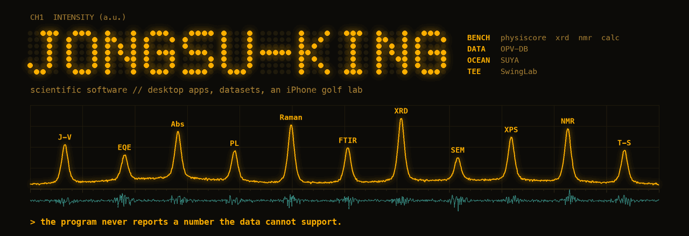

  

  <picture>
    <source media="(prefers-color-scheme: dark)" srcset="https://readme-typing-svg.demolab.com?font=JetBrains+Mono&weight=600&size=20&duration=2600&pause=1000&color=FFB000&center=true&vCenter=true&width=760&height=40&lines=Solar+cells,+from+raw+curve+to+device+parameter;38,849+OPV+devices+mined+from+the+literature;Watching+the+Southern+Ocean,+provenance+attached;Bragg+peaks,+NMR+multiplets,+a+240+fps+golf+swing;Six+DOIs.+Hundreds+of+tests.+No+made-up+numbers.">
    <source media="(prefers-color-scheme: light)" srcset="https://readme-typing-svg.demolab.com?font=JetBrains+Mono&weight=600&size=20&duration=2600&pause=1000&color=8A5A00&center=true&vCenter=true&width=760&height=40&lines=Solar+cells,+from+raw+curve+to+device+parameter;38,849+OPV+devices+mined+from+the+literature;Watching+the+Southern+Ocean,+provenance+attached;Bragg+peaks,+NMR+multiplets,+a+240+fps+golf+swing;Six+DOIs.+Hundreds+of+tests.+No+made-up+numbers.">
    
  </picture>

  
  
  

I build scientific software that shows its work: analysis suites for thin-film solar cells, XRD and NMR, a literature-mined device database, and a desktop monitor for the Southern Ocean. Off the bench, an iPhone golf lab.

실험 데이터를 다루는 과학 소프트웨어를 만듭니다. 원칙은 하나, **데이터가 뒷받침하지 못하는 숫자는 내놓지 않습니다.**

### <kbd>CH1</kbd> Instruments

  
  

  
  

  
  

  

### <kbd>CH2</kbd> On the screen

  
   <b>SUYA</b> · sea surface temperature around Antarctica, with every value's source and age beside it

  
  
   <b>XRD Analyzer</b> · fit and residuals on a labelled synthetic example &nbsp;|&nbsp; <b>NMR Analyzer</b> · overlaid spectra, integrals, multiplets

<b>SwingLab in nine of its twelve languages</b>

 

  

### <kbd>CH3</kbd> Signal

  

  

  
  

  <picture>
    <source media="(prefers-color-scheme: dark)" srcset="https://raw.githubusercontent.com/jongsu-king/jongsu-king/output/snake-dark.svg">
    <source media="(prefers-color-scheme: light)" srcset="https://raw.githubusercontent.com/jongsu-king/jongsu-king/output/snake-light.svg">
    
  </picture>

### <kbd>CH4</kbd> Toolchain

  

<b>Citing and releases</b>

 

| Project | Latest release | DOI | Tests |
| --- | --- | --- | --- |
| [Physiscore](https://github.com/jongsu-king/physiscore) |  |  | — |
| [XRD Analyzer](https://github.com/jongsu-king/xrd-analyzer) |  |  | 294 |
| [NMR Analyzer](https://github.com/jongsu-king/nmr-analyzer) |  |  | 98 |
| [Solution Preparation Calculator](https://github.com/jongsu-king/perovskite-opv-solution-calculator) |  |  | — |
| [OPV-DB](https://github.com/jongsu-king/opv-db-based-on-literature) |  |  | — |
| [SwingLab](https://github.com/jongsu-king/SwingLab) |  |  | 85 + 40 |
| [SUYA](https://github.com/jongsu-king/SUYA) |  | — | 73 |

  

  

