  <picture>
    <source media="(prefers-color-scheme: dark)" srcset="https://raw.githubusercontent.com/jongsu-king/jongsu-king/main/assets/hero-dark.gif">
    <source media="(prefers-color-scheme: light)" srcset="https://raw.githubusercontent.com/jongsu-king/jongsu-king/main/assets/hero-light.gif">
    
  </picture>

I write analysis software for thin-film solar cells, mostly perovskite and organic. A few projects wandered off from that, among them a monitor for the Southern Ocean and a golf app for iPhone.

  <a href="https://github.com/jongsu-king/physiscore"><picture><source media="(prefers-color-scheme: dark)" srcset="https://raw.githubusercontent.com/jongsu-king/jongsu-king/main/assets/fig-a-dark.svg"><source media="(prefers-color-scheme: light)" srcset="https://raw.githubusercontent.com/jongsu-king/jongsu-king/main/assets/fig-a-light.svg"></picture></a>
  <a href="https://github.com/jongsu-king/xrd-analyzer"><picture><source media="(prefers-color-scheme: dark)" srcset="https://raw.githubusercontent.com/jongsu-king/jongsu-king/main/assets/fig-b-dark.svg"><source media="(prefers-color-scheme: light)" srcset="https://raw.githubusercontent.com/jongsu-king/jongsu-king/main/assets/fig-b-light.svg"></picture></a>
  <a href="https://github.com/jongsu-king/nmr-analyzer"><picture><source media="(prefers-color-scheme: dark)" srcset="https://raw.githubusercontent.com/jongsu-king/jongsu-king/main/assets/fig-c-dark.svg"><source media="(prefers-color-scheme: light)" srcset="https://raw.githubusercontent.com/jongsu-king/jongsu-king/main/assets/fig-c-light.svg"></picture></a>
  <a href="https://github.com/jongsu-king/opv-db-based-on-literature"><picture><source media="(prefers-color-scheme: dark)" srcset="https://raw.githubusercontent.com/jongsu-king/jongsu-king/main/assets/fig-d-dark.svg"><source media="(prefers-color-scheme: light)" srcset="https://raw.githubusercontent.com/jongsu-king/jongsu-king/main/assets/fig-d-light.svg"></picture></a>
  <a href="https://github.com/jongsu-king/SUYA"><picture><source media="(prefers-color-scheme: dark)" srcset="https://raw.githubusercontent.com/jongsu-king/jongsu-king/main/assets/fig-e-dark.svg"><source media="(prefers-color-scheme: light)" srcset="https://raw.githubusercontent.com/jongsu-king/jongsu-king/main/assets/fig-e-light.svg"></picture></a>
  <a href="https://github.com/jongsu-king/SwingLab"><picture><source media="(prefers-color-scheme: dark)" srcset="https://raw.githubusercontent.com/jongsu-king/jongsu-king/main/assets/fig-f-dark.svg"><source media="(prefers-color-scheme: light)" srcset="https://raw.githubusercontent.com/jongsu-king/jongsu-king/main/assets/fig-f-light.svg"></picture></a>

The film strip and the pattern at the top are one calculation for α-FAPbI3, so each arc sits above its peak. The panels are plotted from files in the linked repos. <b>a</b> The ASTM G173 spectrum Physiscore integrates EQE against, shaded above the FAPbI3 band gap. <b>b</b> The synthetic example that ships with XRD Analyzer. <b>c</b> A teaching dataset from NMR Analyzer, with the OCH₂ quartet enlarged. <b>d</b> OPV-DB devices with Voc and Jsc in the plotted range; dashed lines are PCE at FF = 0.7. <b>e</b> NOAA OISST on 2 November 2026, cut from a SUYA screenshot. <b>f</b> SwingLab's catalog, the nine largest of 23 brands.

#### Software

<!-- repos:start: generated by scripts/update_readme.py. Edit scripts/projects.json, not this table. -->

| Project |
|:---|
| **[Physiscore](https://github.com/jongsu-king/physiscore)**  J-V, EQE, Abs, PL, Raman, FTIR, XRD, SEM and XPS in one program. Device numbers are calculated from the raw curve, not read from the instrument's summary block. |
| **[XRD Analyzer](https://github.com/jongsu-king/xrd-analyzer)**  <small>[Download](https://github.com/jongsu-king/xrd-analyzer/releases/latest)</small> Peak fitting with uncertainties, Scherrer and Williamson-Hall. Leave out the instrument broadening and it answers `NOT_CALCULABLE`. |
| **[NMR Analyzer](https://github.com/jongsu-king/nmr-analyzer)**  <small>[Download](https://github.com/jongsu-king/nmr-analyzer/releases/latest)</small> 1D and 2D spectra from Bruker, ACD/Labs and JCAMP-DX. Python standard library only. |
| **[XPS AutoFit Studio](https://github.com/jongsu-king/xps-autofit-studio)** <small>[Download](https://github.com/jongsu-king/xps-autofit-studio/releases/latest)</small> Peak fitting with spin-orbit doublet constraints. AICc or BIC picks the number of components, but only among models that pass physical checks, and a close call is flagged as ambiguous. Command line and desktop app. |
| **[Solution Preparation Calculator](https://github.com/jongsu-king/perovskite-opv-solution-calculator)**  Type in <code>Cs0.05FA0.79MA0.16<wbr>Pb(I0.83Br0.17)3</code> and read off what to weigh. Co-authored. |
| **[OPV-DB](https://github.com/jongsu-king/opv-db-based-on-literature)**  38,849 organic PV device records mined from the literature, derived from Qiu's OPV-DB (CC BY 4.0). |
| **[SUYA](https://github.com/jongsu-king/SUYA)**  <small>[Download](https://github.com/jongsu-king/SUYA/releases/latest)</small> Collects sea temperature, salinity and air temperature around Antarctica from NOAA, HYCOM, Argo and others into SQLite and monthly Excel files. |
| **[SwingLab](https://github.com/jongsu-king/SwingLab)**  Swing video with Vision pose, an experimental 240 fps launch monitor and a club catalog back to 2000. iPhone, 12 languages. |
| **[OpenAlex Corpus Harvester](https://github.com/jongsu-king/openalex-corpus-harvester)**  OpenAlex records into a local SQLite corpus, with PDFs extracted to Markdown and structured data. Keeps raw responses, checksums and validation results. Fetches only the PDF URLs it is given. Python 3.11+, MIT. |
| **[anti-reverse-shield](https://github.com/jongsu-king/anti-reverse-shield)**  Defense-in-depth building blocks against automated reverse-engineering tooling (the Ghidra/IDA + Frida + MITM-proxy pipeline that AI RE agents automate). |
| **[homebrew-suya](https://github.com/jongsu-king/homebrew-suya)** Homebrew tap for SUYA, the Antarctic ocean temperature, salinity and air temperature collector |

<!-- repos:end -->

Screenshots

 

  
  
  
  

#### Activity

  <picture>
    <source media="(prefers-color-scheme: dark)" srcset="https://raw.githubusercontent.com/jongsu-king/jongsu-king/output/activity-dark.svg">
    <source media="(prefers-color-scheme: light)" srcset="https://raw.githubusercontent.com/jongsu-king/jongsu-king/output/activity-light.svg">
    
  </picture>

  <picture>
    <source media="(prefers-color-scheme: dark)" srcset="https://raw.githubusercontent.com/jongsu-king/jongsu-king/output/stack-dark.svg">
    <source media="(prefers-color-scheme: light)" srcset="https://raw.githubusercontent.com/jongsu-king/jongsu-king/output/stack-light.svg">
    
  </picture>

<b>g</b> One dot per day, with the same days as sticks underneath. <b>h</b> Commits to public repositories, leaving out this one. <b>i</b> The same commits by repository, each day drawn as a Gaussian peak with height going as the square root of the count. The table and these panels update themselves, so a new public repository appears here on its own. All of it is plotted by the <a href="https://github.com/jongsu-king/jongsu-king/tree/main/scripts">scripts</a> in this repo.
