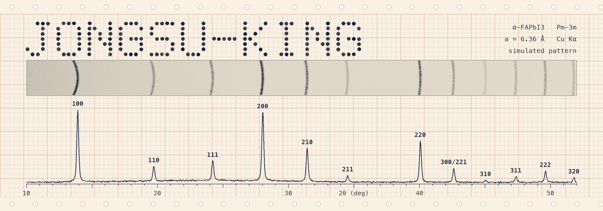
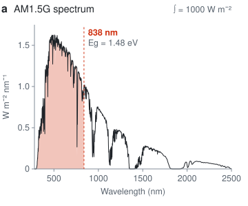
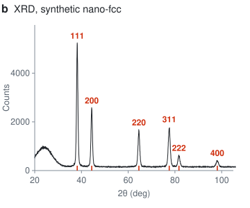
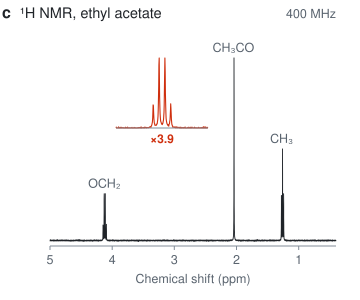
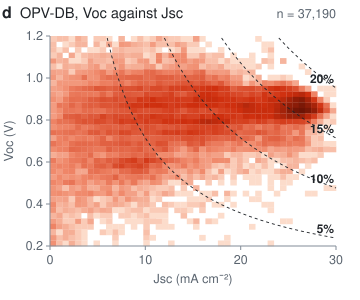
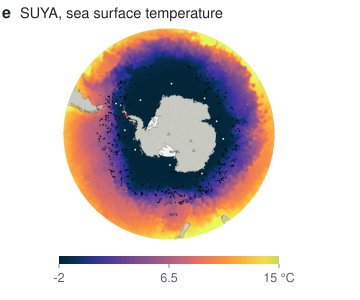
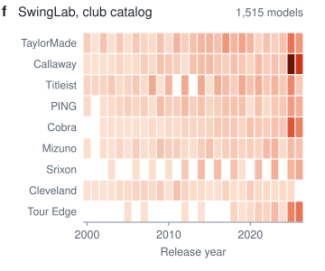

  <picture>
    <source media="(prefers-color-scheme: dark)" srcset="https://raw.githubusercontent.com/jongsu-king/jongsu-king/main/assets/hero-dark.gif">
    <source media="(prefers-color-scheme: light)" srcset="https://raw.githubusercontent.com/jongsu-king/jongsu-king/main/assets/hero-light.gif">
    
  </picture>

I write analysis software for thin-film solar cells, mostly perovskite and organic. Two projects wandered off from that: a monitor for the Southern Ocean and a golf app for iPhone.

박막 태양전지, 주로 페로브스카이트와 유기 태양전지 분석 소프트웨어를 만듭니다. 남극해 모니터링 앱이랑 아이폰 골프 앱도 있어요.

  <a href="https://github.com/jongsu-king/physiscore"><picture><source media="(prefers-color-scheme: dark)" srcset="https://raw.githubusercontent.com/jongsu-king/jongsu-king/main/assets/fig-a-dark.svg"><source media="(prefers-color-scheme: light)" srcset="https://raw.githubusercontent.com/jongsu-king/jongsu-king/main/assets/fig-a-light.svg"></picture></a>
  <a href="https://github.com/jongsu-king/xrd-analyzer"><picture><source media="(prefers-color-scheme: dark)" srcset="https://raw.githubusercontent.com/jongsu-king/jongsu-king/main/assets/fig-b-dark.svg"><source media="(prefers-color-scheme: light)" srcset="https://raw.githubusercontent.com/jongsu-king/jongsu-king/main/assets/fig-b-light.svg"></picture></a>
  <a href="https://github.com/jongsu-king/nmr-analyzer"><picture><source media="(prefers-color-scheme: dark)" srcset="https://raw.githubusercontent.com/jongsu-king/jongsu-king/main/assets/fig-c-dark.svg"><source media="(prefers-color-scheme: light)" srcset="https://raw.githubusercontent.com/jongsu-king/jongsu-king/main/assets/fig-c-light.svg"></picture></a>
  <a href="https://github.com/jongsu-king/opv-db-based-on-literature"><picture><source media="(prefers-color-scheme: dark)" srcset="https://raw.githubusercontent.com/jongsu-king/jongsu-king/main/assets/fig-d-dark.svg"><source media="(prefers-color-scheme: light)" srcset="https://raw.githubusercontent.com/jongsu-king/jongsu-king/main/assets/fig-d-light.svg"></picture></a>
  <a href="https://github.com/jongsu-king/SUYA"><picture><source media="(prefers-color-scheme: dark)" srcset="https://raw.githubusercontent.com/jongsu-king/jongsu-king/main/assets/fig-e-dark.svg"><source media="(prefers-color-scheme: light)" srcset="https://raw.githubusercontent.com/jongsu-king/jongsu-king/main/assets/fig-e-light.svg"></picture></a>
  <a href="https://github.com/jongsu-king/SwingLab"><picture><source media="(prefers-color-scheme: dark)" srcset="https://raw.githubusercontent.com/jongsu-king/jongsu-king/main/assets/fig-f-dark.svg"><source media="(prefers-color-scheme: light)" srcset="https://raw.githubusercontent.com/jongsu-king/jongsu-king/main/assets/fig-f-light.svg"></picture></a>

The film strip and the pattern at the top are one calculation for α-FAPbI3, so each arc sits above its peak. The panels are plotted from files in the linked repos. <b>a</b> The ASTM G173 spectrum Physiscore integrates EQE against, shaded above the FAPbI3 band gap. <b>b</b> The synthetic example that ships with XRD Analyzer. <b>c</b> A teaching dataset from NMR Analyzer, with the OCH₂ quartet enlarged. <b>d</b> OPV-DB devices with Voc and Jsc in the plotted range; dashed lines are PCE at FF = 0.7. <b>e</b> NOAA OISST on 2 November 2026, cut from a SUYA screenshot. <b>f</b> SwingLab's catalog, the nine largest of 23 brands.

#### Software

- **[Physiscore](https://github.com/jongsu-king/physiscore)** J-V, EQE, Abs, PL, Raman, FTIR, XRD, SEM and XPS in one program. Device numbers are calculated from the raw curve, not read from the instrument's summary block. [DOI](https://doi.org/10.5281/zenodo.22267588)
- **[XRD Analyzer](https://github.com/jongsu-king/xrd-analyzer)** Peak fitting with uncertainties, Scherrer and Williamson-Hall. Leave out the instrument broadening and it answers `NOT_CALCULABLE`. [DOI](https://doi.org/10.5281/zenodo.23912324)
- **[NMR Analyzer](https://github.com/jongsu-king/nmr-analyzer)** 1D and 2D spectra from Bruker, ACD/Labs and JCAMP-DX. Python standard library only. [DOI](https://doi.org/10.5281/zenodo.23682459)
- **[Solution Preparation Calculator](https://github.com/jongsu-king/perovskite-opv-solution-calculator)** Type in `Cs0.05FA0.79MA0.16Pb(I0.83Br0.17)3` and read off what to weigh. Co-authored. [DOI](https://doi.org/10.5281/zenodo.23682461)
- **[OPV-DB](https://github.com/jongsu-king/opv-db-based-on-literature)** 38,849 organic PV device records mined from the literature, derived from Qiu's OPV-DB (CC BY 4.0). [DOI](https://doi.org/10.5281/zenodo.23682463)
- **[SUYA](https://github.com/jongsu-king/SUYA)** Collects sea temperature, salinity and air temperature around Antarctica from NOAA, HYCOM, Argo and others into SQLite and monthly Excel files.
- **[SwingLab](https://github.com/jongsu-king/SwingLab)** Swing video with Vision pose, an experimental 240 fps launch monitor and a club catalog back to 2000. iPhone, 12 languages. [DOI](https://doi.org/10.5281/zenodo.23682465)

Screenshots

 

  
  
  
  

#### Activity

  <picture>
    <source media="(prefers-color-scheme: dark)" srcset="https://raw.githubusercontent.com/jongsu-king/jongsu-king/output/activity-dark.svg">
    <source media="(prefers-color-scheme: light)" srcset="https://raw.githubusercontent.com/jongsu-king/jongsu-king/output/activity-light.svg">
    
  </picture>

All of it is plotted by the <a href="https://github.com/jongsu-king/jongsu-king/tree/main/scripts">scripts</a> in this repo.
